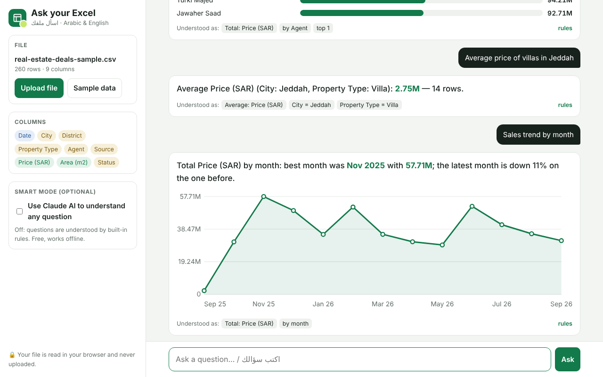
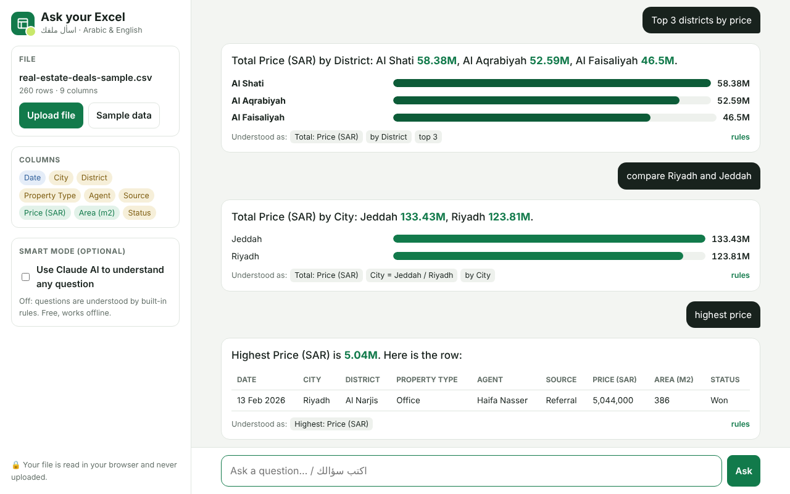

# Ask your Excel · اسأل ملفك

When I took an Excel course, I noticed that many simple questions about a sheet still need a pivot table or a formula before you get the answer.

So I made this: upload the sheet, type the question in Arabic or English, and get the answer.

**Try it:** https://noorsl.github.io/ask-your-excel/ (click **Try sample data**)

## Questions you can ask

The sample file is made-up real estate deals. Try:

**In English**

- Who is the best agent?
- How many deals are Won?
- Sales trend by month
- Compare Riyadh and Jeddah
- Top 3 districts by price

**بالعربي**

- مين أفضل وسيط؟
- كم مبيعات جواهر الشهر الماضي؟
- متوسط السعر للفلل في جدة

**School report:** upload a grades file (try `grades_1447.xlsx` in this repo; the students are made up) and click **📋 School report**. You get a printable report: students who need follow-up, weakest subject, class comparison, attendance and an honor roll.

Under every answer there is a small line, **“Understood as”**, showing exactly what the tool calculated (for example *Total: Price (SAR) · Agent = Jawaher Saad · Aug 2026*). If it misunderstood you, you see it straight away.

## How it works

The question is turned into a small plan: what to calculate, which filters, which period and how to group. The plan then runs on the data inside your browser.

The tool understands words like total, average, how many, best and lowest in both languages, plus months and “last month / this year”. A small dictionary links Arabic and English values, so “الرياض” finds “Riyadh” and “الفلل” finds “Villa”. It is free and works offline.

Your file is never uploaded anywhere.

## Notes

- Reads `.xlsx`, `.csv` and `.tsv` (save old `.xls` files as `.xlsx` first)
- The sample deals and agent names are made up

## Next

- Follow-up questions (“and in Jeddah?”)
- Percent change between two periods
- Save an answer as an image to share on WhatsApp

— Bothynah Alsnany · MIT License
